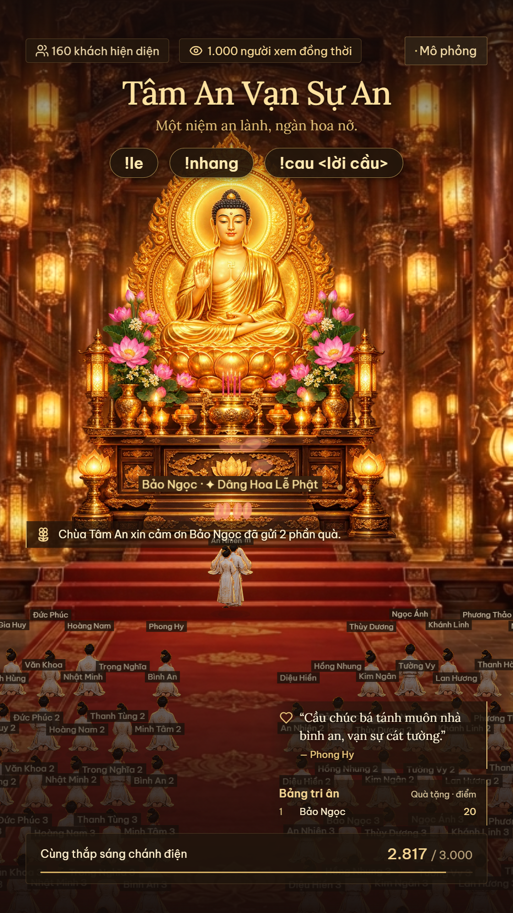

# Tâm An Vạn Sự An · Chùa Phong Linh LIVE

> *Một niệm an lành, ngàn hoa nở.*

Không gian chánh điện tương tác trực tiếp chạy ngay trên máy của bạn, thiết kế chuyên biệt cho buổi **LIVE TikTok** dọc chuẩn **9:16 (1080×1920)**: góc nhìn đại điện mở rộng `3/2`, chu trình máy quay điện ảnh đa góc độ lướt chậm rãi êm ái, đội hình **200 phật tử** ngồi đối xứng hai bên với hành lang chính giữa trang nghiêm, **3 vị trí danh dự** bước lên trước bàn thờ Phật dâng hoa / thắp hương / vái lạy, tự động nhận diện thông minh & đọc lời cầu nguyện bằng **giọng đọc AI tiếng Việt** mở đầu *"Chùa Tâm An..."*, hiệu ứng hào quang đắc đạo cho Đại thí chủ cúng dường, cùng Bảng tri ân và cột mốc công đức cộng đồng. Mặc định có sẵn chế độ **mô phỏng** để trải nghiệm ngay mà không cần tài khoản TikTok.

**Công nghệ:** Phaser 4.2.1 · React 19 · TypeScript 5.8 · Vite 6 · Node.js 24 · SQLite

---

## Giao diện & Góc máy

<table>
  <tr>
    <td align="center" valign="top" width="50%">
      <br>
      <sub><b>Đạo tràng · Góc Toàn cảnh</b> (<code>/overlay</code>, <code>/game</code>)<br>Khung dọc chuẩn 9:16 với góc nhìn đại điện mở rộng 3/2, đội hình 2 bên (10 hàng × 10 người/bên = <b>200 phật tử</b>), hành lang giữa rộng rãi và 3 vị trí danh dự trước Tam Bảo.</sub>
    </td>
    <td align="center" valign="top" width="50%">
      <br>
      <sub><b>Đạo tràng · Góc Cận cảnh & Chiều sâu</b><br>Máy quay tự động lướt chậm rãi, soi rõ tượng Phật, bàn thờ Tam Bảo, từng người quỳ lễ và bảng tên thếp vàng của Phật tử hai bên.</sub>
    </td>
  </tr>
</table>

<table>
  <tr>
    <td align="center" valign="top" width="50%">
      <br>
      <sub><b>Phòng điều khiển</b> (<code>/admin</code>)<br>Xem trước trực tiếp 60 FPS, gửi tương tác thử, mô phỏng người xem lấp đầy 200 phật tử, theo dõi Bảng tri ân và lịch sử sự kiện.</sub>
    </td>
    <td align="center" valign="top" width="50%">
      <br>
      <sub><b>Cài đặt & Kết nối</b> (<code>/admin</code>)<br>Tùy chỉnh góc máy, giọng đọc AI tiếng Việt, âm nền, tiếng chuông, ánh xạ 18 loại quà tặng TikTok và kết nối TikTok LIVE.</sub>
    </td>
  </tr>
</table>

---

## Tính năng nổi bật & Nâng cấp mới

### 1. Đội hình 200 Phật tử & Tự động lấp đầy theo mắt xem Live
- **Mở rộng quy mô 200 chỗ ngồi:** Đội hình phân bổ cân đối 2 bên tả – hữu, mỗi bên gồm **10 hàng × 10 người** (`100 người/bên`), giữ nguyên **hành lang trung tâm thênh thang** và khoảng sân hành lễ trang nghiêm trước Phật đài.
- **Tự động lấp đầy đạo tràng:** Khi phòng live đạt lượng người xem đông (hàng trăm đến hàng nghìn mắt xem), hệ thống tự động lấp kín 200 vị trí. Người xem TikTok tương tác thật được ưu tiên xếp chỗ ngồi trang trọng trong 5 phút.

### 2. Chu trình Camera điện ảnh lướt chậm rãi & Cận cảnh chân thực
- **Kéo dài chu trình lên 22 giây mỗi góc quay:**
  - **7.7 giây đầu (~35% thời lượng):** Camera chuyển động lướt cực kỳ êm ái, an tịnh từ góc trước sang góc mới.
  - **14.3 giây tiếp theo (~65% thời lượng):** Camera dừng lại ngắm cận cảnh tĩnh lặng kết hợp nhịp thở phong thủy khẽ khàng, giúp người xem ngắm rõ bản thân và không gian chùa mà không bị cảm giác lia máy vội vàng.
- **6 góc quay đa dạng:** Cận cảnh 3 người dâng hương trước Tam Bảo (zoom 2.24×), Cận cảnh khối Phật tử cánh tả (zoom 1.85×), Cận cảnh khối Phật tử cánh hữu (zoom 1.85×), Toàn cảnh đại điện ấm cúng, Cận cao kim thân Phật tổ, và Góc nhìn dọc hành lang trung tâm.

### 3. Phân cấp 4 tầng Quà tặng & Hiệu ứng "Hào quang Phật đắc đạo"
- **Tier 1 (< 20 điểm):** Lấp lánh ánh kim tuyến nhẹ nhàng.
- **Tier 2 (20 – 99 điểm):** Camera chuyển động bám theo người dâng lễ, mưa hoa sen.
- **Tier 3 (100 – 999 điểm):** Camera zoom cận cảnh 2.3×, xuất hiện vòng hào quang Phật pháp 175px sau đầu, mưa 70 cánh sen vàng.
- **Tier 4 (Từ 1.000 điểm trở lên - Du thuyền, Sư tử, Pháo hoa...):**
  - Xuất hiện **Vòng đại hào quang Phật đắc đạo 250px** đa tầng ánh sáng vàng rực xoay tròn liên tục quanh đầu thí chủ.
  - **Toàn bộ 200 Phật tử** trong đại điện đồng loạt phủ phục cúi lạy trong 6.5 giây để cảm tạ đại công đức.
  - Rung chấn màn hình trang trọng (screen shake 380ms) và mưa 130 cánh hoa sen vàng rực rỡ.
  - Vinh danh trên banner hoàng kim: `✦ ĐẠI THÍ CHỦ CÚNG DƯỜNG ✦`.

### 4. Tự động nhận diện thông minh Lời cầu nguyện & Lời chúc
- **Tự động lọc sạch dấu ngoặc:** Người xem gõ `!cau< chúc sức khỏe >`, `!cau<bình an>`, `!cầu: an lành` hay `!cau [vạn sự như ý]` đều được tự động làm sạch thành văn bản thuần túy, không còn bị đọc thành "ngoặc nhọn ngoặc vuông".
- **Nhận diện bình luận tự nhiên (không cần gõ `!cau`):**
  - Người xem gõ `adidaphat chúc gia đình luôn bình an`, `a di đà phật cầu cho con thi đỗ`, `nam mô a di đà phật con cầu sức khỏe`... hệ thống tự động tách câu niệm Phật, lấy lời nguyện đưa lên khung text và cho bot đọc ngay!
  - Gõ tự do chứa từ khóa tâm nguyện (`chúc`, `cầu`, `nguyện`, `mong`, `xin`, `bình an`, `sức khỏe`...) đều được tự động ghi nhận là Lời cầu an.
  - Nếu chỉ gõ niệm Phật đơn thuần (`A Di Đà Phật`): Hệ thống nhận diện là Lễ Phật, Phật tử cúi lạy và phóng đốm sáng bay lên Tam Bảo (không chen vào giọng đọc).

### 5. Hàng đợi Ưu tiên & Quy tắc chào đón 1/5 (80/20)
- **Hàng đợi ưu tiên (Quà tặng > Lời cầu > Lời chào):** Quà tặng luôn được xếp lên vị trí số 1, kế tiếp là lời cầu nguyện `!cau`.
- **Đọc trọn vẹn, không ngắt dở:** Bot sẽ đọc cho xong câu chào hiện tại một cách tự nhiên, êm ái, sau đó lập tức đọc tiếp lời cảm ơn quà tặng / lời cầu nguyện đã được ưu tiên đưa lên đầu hàng đợi.
- **Quy tắc chào đón 1/5 khi từ 100 người xem trở lên:**
  - **80% (4/5 khách):** Chỉ đọc câu chào ngắn gọn 2-3s (*"Chùa Tâm An xin chào đón [Tên] đã ghé thăm chùa"*).
  - **20% (Cứ mỗi người thứ 5):** Đọc chào đón kèm lời chúc phúc cát tường.
  - Giúp lời chúc trở nên đắt giá, trang trọng, không bị ngợp hay nghẽn hàng đợi âm thanh.
- **Kho 115 lời chúc Phật pháp:** Tích hợp sẵn tại `data/blessings.json` với thuật toán chống trùng lặp câu liền kề.

### 6. Giao diện Live siêu thoáng đãng
- Bỏ cụm thông báo hành lễ và dải chữ lời dẫn nhảy giữa màn hình để không che khuất tượng Phật và cảnh chùa.
- Giữ tinh gọn bảng tên Phật tử, dải hướng dẫn tương tác không có ngoặc rối mắt (`!le`, `!nhang`, `!cau lời cầu`), khung lời cầu nguyện và thanh tiến độ công đức.

---

## Bắt đầu nhanh

### Cách 1: Chạy nhanh trên Windows bằng `ChayChua.bat` (Khuyến nghị)

Chỉ cần nhấp đúp vào tệp **`ChayChua.bat`** trong thư mục dự án:
- Tự động khởi chạy máy chủ trên cổng `80` (hoặc cổng cấu hình trong `.env`).
- Tự động mở trình duyệt vào bảng điều khiển [`http://lvh.me/admin`](http://lvh.me/admin).

| Đường dẫn nhanh (`lvh.me`) | Đường dẫn mặc định (`localhost:3000`) | Công dụng |
| --- | --- | --- |
| [`http://lvh.me/admin`](http://lvh.me/admin) | [`http://127.0.0.1:3000/admin`](http://127.0.0.1:3000/admin) | **Phòng điều khiển** dành cho người vận hành |
| [`http://lvh.me/game`](http://lvh.me/game) | [`http://127.0.0.1:3000/game`](http://127.0.0.1:3000/game) | **Đạo tràng**: xem trực tiếp có âm thanh |
| [`http://lvh.me/overlay`](http://lvh.me/overlay) | [`http://127.0.0.1:3000/overlay`](http://127.0.0.1:3000/overlay) | **Nguồn OBS (Hình ảnh)**: chỉ cảnh chùa chuẩn 9:16 |
| [`http://lvh.me/overlay?audio=1`](http://lvh.me/overlay?audio=1) | [`http://127.0.0.1:3000/overlay?audio=1`](http://127.0.0.1:3000/overlay?audio=1) | **Nguồn OBS (Có âm thanh & giọng đọc AI)** |

### Cách 2: Chạy bằng dòng lệnh (`npm`)

```sh
npm install
npm run dev
```

Chạy bản production:
```sh
npm run build
npm start
```

---

## Đẩy cập nhật lên GitHub bằng `DayLenGitHub.bat`

Khi bạn có các chỉnh sửa mới hoặc muốn đồng bộ toàn bộ dự án lên kho GitHub cá nhân:
1. Nhấp đúp vào tệp **`DayLenGitHub.bat`**.
2. Công cụ sẽ tự động:
   - Nhận diện Git trên máy tính.
   - Tự động đóng gói tất cả các tệp mã nguồn, tài nguyên và cấu hình lời chúc mới.
   - Tạo commit với mô tả chi tiết các tính năng.
   - Đẩy thẳng lên nhánh `main` của kho lưu trữ `https://github.com/phonghy/chua-phong-linh-live`.

---

## Tương tác của người xem trên TikTok LIVE

| Bình luận / Sự kiện | Hành động trong Chánh điện | Điểm công đức & Hiệu ứng |
| :--- | :--- | :--- |
| `!le`, `!lễ`, `le`, `lễ`, `!lay`, `!lạy`, `lạy` | **Lễ Phật**: Phật tử đại diện chắp tay vái lạy | `+1` điểm công đức, hoa đăng sáng |
| `!nhang`, `nhang`, `!huong`, `!hương`, `hương` | **Thắp nhang**: Dâng hương trước lư đồng | `+1` điểm công đức, khói hương trầm |
| `!cau <lời cầu>`, `cầu <lời cầu>`, `adidaphat chúc...`, `chúc...` | **Cầu nguyện**: Tự động lọc sạch ngoặc `<>`, hiện khung text và **Giọng AI đọc vang lời cầu** | `+1` điểm công đức, giọng AI đọc tri ân ưu tiên |
| **Bình luận niệm Phật (`A Di Đà Phật`)** | Tỏa hào quang hoa sen vàng ấm áp, đốm sáng tâm nguyện bay lên Tam Bảo | Phật tử cúi lạy niệm Phật |
| **Tặng Quà LIVE** | **Cúng dường Tam Bảo**: Kích hoạt hiệu ứng theo 4 cấp độ (Tier 1 – Tier 4) | Cộng điểm theo quà, mưa sen vàng, giọng AI cảm ơn và vòng hào quang đắc đạo |
| **Vào phòng LIVE (`join`)** | Xuất hiện trong đại điện (sức chứa 200 người) | Giọng AI chào đón theo cơ chế 1/5 |
| **Theo dõi (`follow`) / Chia sẻ (`share`)** | Tỏa sáng đại điện & Giọng AI cảm ơn | Tăng bộ đếm công đức |
| **Thả tim (`like`)** | Hiệu ứng ánh sáng ấm áp | Tăng bộ đếm yêu thương |

---

## Cấu trúc thư mục

- `apps/web`: Giao diện React 19, cảnh chùa Phaser 4.2.1 (`game.ts`), bố cục lớp phủ (`TempleView.tsx`, `Leaderboard.tsx`, `style.css`), âm thanh & bộ máy giọng đọc ưu tiên (`audio.ts`, `narrator.ts`).
- `apps/server`: Engine điều phối trạng thái (`engine.ts`), kho 115 lời chúc (`blessings.ts`), lưu trữ SQLite (`store.ts`), tổng hợp giọng đọc AI (`narrator.ts`), kết nối TikTok LIVE (`connectors.ts`).
- `packages/shared`: Schema kiểm tra hợp lệ (Zod) và các kiểu dữ liệu dùng chung.
- `data/`: Chứa cơ sở dữ liệu `temple.sqlite` và kho lời chúc Phật giáo `blessings.json`.
- `ChayChua.bat`: Khởi động ứng dụng 1 chạm trên Windows.
- `DayLenGitHub.bat`: Đẩy toàn bộ cập nhật lên GitHub 1 chạm.
