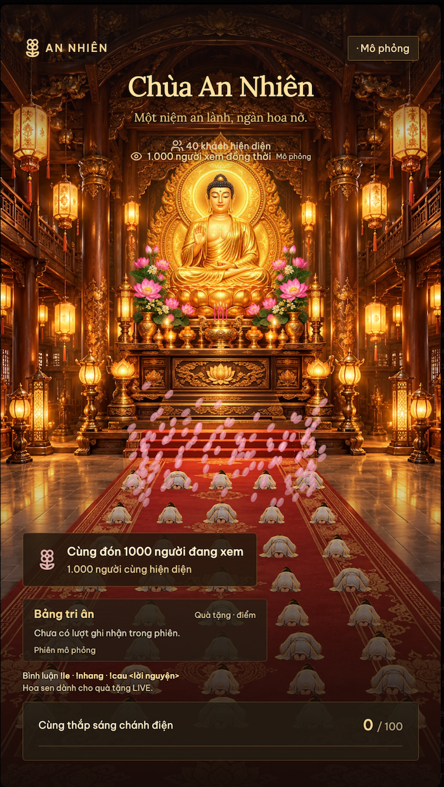
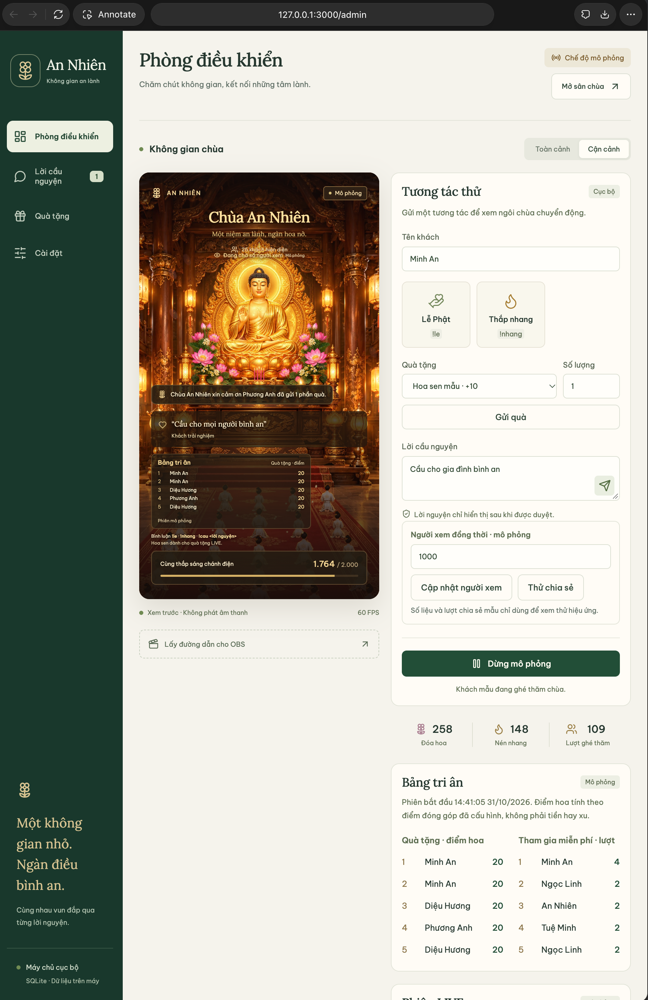
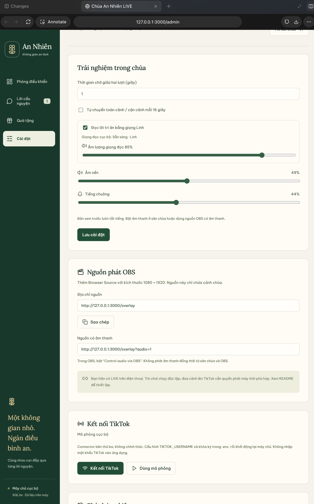

# Chùa Phong Linh LIVE

> *Một niệm an lành, ngàn hoa nở.*

Trò chơi tương tác chạy ngay trên máy của bạn, dành cho buổi LIVE TikTok: cảnh dọc 1080×1920, khách lễ Phật, dâng hoa, thắp nhang, lời nguyện có duyệt và cột mốc chung của cả cộng đồng. Mặc định chạy ở chế độ **mô phỏng**, không cần tài khoản TikTok để thử.

**Công nghệ:** Phaser 4.2.1 · React · TypeScript · Node.js 24 · SQLite

## Giao diện

<table>
  <tr>
    <td align="center" valign="top" width="34%">
      <br>
      <sub><b>Đạo tràng</b> (<code>/game</code>, <code>/overlay</code>)<br>Cảnh dọc 9:16 dùng cho OBS. Ảnh chụp lúc đạt mốc 1.000 người xem (mô phỏng).</sub>
    </td>
    <td align="center" valign="top" width="66%">
      <br>
      <sub><b>Phòng điều khiển</b> (<code>/admin</code>)<br>Xem trước cảnh, gửi tương tác thử, cập nhật số người xem, theo dõi Bảng tri ân.</sub>
    </td>
  </tr>
</table>

<p align="center">
  <br>
  <sub><b>Cài đặt</b>: giọng đọc Linh, âm nền, tiếng chuông, đường dẫn nguồn OBS và kết nối TikTok.</sub>
</p>

## Tính năng chính

- Cảnh chùa vẽ nhiều lớp kiểu 2.5D: bàn thờ, đèn lồng, thảm đỏ, tối đa **40 khách** quỳ lễ cùng lúc; hai góc nhìn toàn cảnh và cận cảnh.
- Tương tác miễn phí bằng bình luận: `!le`, `!nhang`, `!cau <lời nguyện>`. Hoa sen dành cho người gửi **quà tặng LIVE**.
- **Lời nguyện có duyệt**: chỉ hiện công khai sau khi người vận hành bấm Duyệt.
- **Bảng tri ân theo từng phiên LIVE**: điểm quà tặng và lượt tham gia miễn phí, mỗi bảng hiển thị năm người đầu.
- **Người dẫn chuyện tiếng Việt** (giọng Linh trên macOS) đọc lời cảm ơn, nhạc nền tự nhỏ khi đọc.
- Cột mốc cộng đồng: điểm đóng góp chung và số **người xem đồng thời**; lời mời chia sẻ có giới hạn tần suất.
- Dữ liệu lưu cục bộ bằng SQLite; admin, game và nguồn OBS đồng bộ qua WebSocket.

## Bắt đầu nhanh

Cần Node.js **24**, npm và Make. Chạy trong thư mục dự án:

```sh
make setup
make
```

`make setup` cài phụ thuộc và tạo `.env` từ `.env.example` nếu chưa có; tệp `.env` hiện có được giữ nguyên. Dùng `make run` để khởi động lại máy chủ, Ctrl+C để dừng, `make help` để xem các lệnh, `make install` để chỉ cài phụ thuộc và `make test` để chạy unit/integration tests.

Mở [Phòng điều khiển](http://127.0.0.1:3000/admin) và bấm **Chạy mô phỏng** để thêm 24 khách mẫu và tự động gửi tương tác; bấm **Dừng mô phỏng** để dừng. Khách rời cảnh sau hai phút không hoạt động, nhưng điểm và lịch sử vẫn được giữ.

| Đường dẫn | Dùng để |
| --- | --- |
| [`/admin`](http://127.0.0.1:3000/admin) | Phòng điều khiển cho người vận hành |
| [`/game`](http://127.0.0.1:3000/game) | Đạo tràng: hướng dẫn bình luận/quà TikTok, bảng tri ân, nút bật/tắt tiếng. Tương tác thử nằm trong quản trị |
| [`/overlay`](http://127.0.0.1:3000/overlay) | Nguồn OBS: chỉ cảnh chùa, không có điều khiển |
| [`/overlay?audio=1`](http://127.0.0.1:3000/overlay?audio=1) | Nguồn OBS có âm thanh |

Chạy bản production:

```sh
make build
make start
```

Dừng máy chủ phát triển trước khi chạy production trên cùng cổng. Có thể đổi `PORT` và `TEMPLE_DB` trong `.env` (sao chép từ `.env.example`). Ứng dụng chỉ lắng nghe `127.0.0.1`, không được triển khai công khai như một dịch vụ có xác thực.

## Ứng dụng máy tính (macOS, Windows)

### Cách tải

1. **Bản phát hành (khuyến nghị):** mở trang Releases của kho lưu trữ và tải tệp phù hợp: `…-macos-arm64.tar.gz` (Mac chip Apple M), `…-macos-x64.tar.gz` (Mac Intel) hoặc `…-windows-x64.zip` (Windows). Kèm `SHA256SUMS` để kiểm tra tệp. Release chỉ được tạo khi đẩy tag bắt đầu bằng `v`, ví dụ `git tag v0.1.0 && git push origin v0.1.0`; tag không có chữ `v` (như `0.1`) sẽ không tạo bản tải.
2. **Bản dựng thử từ mỗi lần đẩy code:** mở tab Actions trên GitHub, chọn lần chạy thành công mới nhất, kéo xuống mục **Artifacts** và tải tệp theo hệ điều hành (cần đăng nhập GitHub; lưu 14 ngày).
3. **Tự dựng:** xem hướng dẫn ở cuối mục này.

### Cách chạy

Giải nén rồi chạy tệp `ChuaAnNhien-…`. Một cửa sổ dòng lệnh mở ra, trình duyệt tự mở trang quản trị; đóng cửa sổ đó (hoặc Ctrl+C) để thoát. Không cần cài Node hay Bun.

- Dữ liệu: macOS `~/Library/Application Support/ChuaAnNhien`, Windows `%APPDATA%\ChuaAnNhien` (đổi bằng biến môi trường `TEMPLE_HOME`; `TEMPLE_DB` và `PORT` vẫn dùng được). Sao lưu bằng cách sao chép thư mục này khi ứng dụng đã dừng.
- Cổng mặc định 3000; nếu đã có bản đang chạy, ứng dụng chỉ mở lại trang quản trị. Tùy chọn: `--no-open`, `--port <số>`.
- Bản dựng **chưa ký số**: macOS có thể chặn lần đầu (`xattr -d com.apple.quarantine ./ChuaAnNhien-darwin-*`); Windows SmartScreen có thể cảnh báo.
- Giọng dẫn Linh chỉ có trên macOS; Windows chạy không có giọng dẫn (lời cảm ơn vẫn hiện trên hình).

Tự dựng cục bộ cần [Bun](https://bun.sh) ≥ 1.4.4: `npm ci`, rồi `npm run package` (máy hiện tại) hoặc `npm run package -- --target bun-windows-x64` / `bun-darwin-arm64` / `bun-darwin-x64`. Kết quả ở `release/`; kiểm tra bằng `node scripts/smoke-desktop.mjs release/<tệp>`. Workflow `.github/workflows/build.yml` dựng và kiểm tra cả ba bản trên máy chủ GitHub, và tạo Release khi đẩy tag `v*`.

## Tương tác của người xem

| Đầu vào | Hành động mặc định |
| --- | --- |
| `!le` | Lễ Phật, +1 điểm chung |
| `!nhang` | Thắp nhang, +1 điểm chung |
| `!sen` | Hướng dẫn dâng hoa bằng quà tặng LIVE; không cộng điểm |
| `!cau <nội dung>` | Gửi lời nguyện chờ duyệt, +1 điểm chung |
| Quà tặng | Theo quy tắc trong tab Quà tặng |
| Quà chưa ánh xạ | Dâng hoa nhẹ, +1 điểm mỗi lượt |
| Like / follow | Hiệu ứng nhẹ, không cộng điểm |

Lệnh không phân biệt chữ hoa/thường; mặc định mỗi khách chờ 10 giây giữa các lệnh hợp lệ. Lời nguyện tối đa 240 ký tự và không xuất hiện công khai cho đến khi được duyệt. Tên khách được hiển thị dưới dạng văn bản, không thực thi HTML.

Mốc 100/250/500 làm sáng thêm ánh đèn; các mốc 500 tiếp theo kích hoạt lễ hoa sen. Đợt quà lớn được gộp hiệu ứng về mốc cao nhất, vẫn giữ đủ số điểm. Tối đa 40 khách và 180 hạt hiệu ứng; quá tải hình ảnh được gộp, không nhân đôi điểm. Các mã `mock-*` chỉ là quà mẫu, không phải mã quà TikTok thật.

## Quản trị

- **Lời cầu nguyện**: Duyệt hoặc Ẩn từng lời nguyện.
- **Quà tặng**: ánh xạ mã quà thật sang hiệu ứng và điểm.
- **Cài đặt**: âm lượng, thời gian chờ, tự chuyển góc nhìn, giọng đọc, đường dẫn OBS và kết nối TikTok.
- Bản xem trước trong quản trị luôn tắt tiếng. Nhạc nền phát lặp lại với thanh âm lượng nền, tiếng chuông có thanh riêng. Trên trình duyệt thường cần bấm **Bật âm thanh** ở Đạo tràng.
- **Phát lại** tạo sự kiện thử mới từ 20 sự kiện gần nhất. Hành động hợp lệ có thể cộng điểm thêm; đây không phải chức năng khôi phục dữ liệu. Nguồn `replay` được ghi riêng trong lịch sử.

### Bảng tri ân theo phiên LIVE

Người xem tham gia bằng **bình luận TikTok hoặc gửi quà trong TikTok**. Các nút trong quản trị chỉ dành cho người điều khiển mô phỏng; không cần người xem chạm vào hình phát sóng. Lễ Phật, nhang và lời nguyện vẫn miễn phí; dâng hoa sen cần quà tặng. Đặt mã quà thật trong tab **Quà tặng**.

Bảng **Quà tặng** ghi nhận điểm đóng góp theo ánh xạ quà, không phải tiền hay xu. Bảng **Tham gia miễn phí** ghi nhận lệnh lễ/nhang hợp lệ và lời nguyện sau khi duyệt. Mỗi bảng hiển thị năm người đầu, vẫn lưu điểm của những người còn lại. Cooldown, sự kiện trùng và gói chuỗi quà không tạo lượt ghi nhận thêm. Dữ liệu phát lại hoặc mô phỏng trong phiên TikTok không vào bảng LIVE.

Trong quản trị, **Bắt đầu phiên mới → Xác nhận phiên mới** đặt lại bảng của phiên, giữ nguyên tiến độ chung, cài đặt, ánh xạ và lời nguyện. Đổi giữa mô phỏng và TikTok tạo phiên mới; kết nối lại cùng chế độ giữ phiên. Khởi động lại máy chủ giữ bảng gần nhất; nếu muốn thử mô phỏng sau một phiên TikTok đã lưu, hãy bắt đầu phiên mới.

### Người dẫn chuyện tiếng Việt

Máy macOS có giọng **Linh** dùng bộ tổng hợp cục bộ để tạo WAV; không cần tài khoản dịch vụ TTS. **Cài đặt** hiển thị giọng có khả dụng hay không, cho phép bật/tắt lời dẫn và chỉnh âm lượng riêng. Nếu thiếu giọng hoặc tổng hợp thất bại, lời cảm ơn vẫn hiện trên hình. Hệ điều hành khác macOS báo giọng không khả dụng.

Một chuỗi quà hoàn tất được cảm ơn một lần, đọc tên đã làm sạch; follow được giới hạn tần suất. Lời nguyện chưa duyệt không được đọc. Các lời dẫn xếp hàng tuần tự, tối đa 12 mục và bỏ mục cũ quá 20 giây. Nhạc tự nhỏ khi đọc rồi trở lại mức đã đặt. Nguồn OBS dùng `?audio=1`; chỉ phát tiếng ở một cửa sổ/nguồn để tránh lặp. Tải lại hoặc bật âm thanh không phát lại các lời cảm ơn đã có sẵn.

### Cột mốc khán giả và chia sẻ

Số **người xem đồng thời** lấy từ thống kê phòng TikTok, tách khỏi số nhân vật trong cảnh và điểm đóng góp. Mốc 100/250/500/1.000, rồi mỗi 1.000 tiếp theo, kích hoạt lễ chung một lần trong phiên. Khi tăng qua nhiều mốc cùng lúc, chỉ trình diễn mốc cao nhất; số liệu giảm rồi quay lại không kích hoạt lại. Hiệu ứng dùng chung giới hạn 180 hạt và tối đa 40 nhân vật. Trình duyệt yêu cầu giảm chuyển động nhận ít hạt và bỏ nhịp sáng tăng cường.

Mất kết nối, khởi động lại hoặc quá 30 giây chưa có thống kê mới sẽ hiện **Đang chờ số người xem**. Mốc đã đạt và số người xem cao nhất vẫn được giữ khi nối lại. Hãy **Bắt đầu phiên mới** trước một buổi LIVE mới để đặt lại bảng và mốc khán giả; tiến độ đóng góp chung vẫn được giữ.

Lượt chia sẻ nhận lời cảm ơn; cùng người được đọc tối đa một lần mỗi 60 giây. Lời mời chia sẻ hiện và đọc tối đa mỗi 5 phút khi đang kết nối và có số liệu khán giả mới, tránh 20 giây ngay sau lễ khán giả. Ứng dụng không tự gửi bình luận vào TikTok. Trong quản trị, **Người xem đồng thời · mô phỏng → Cập nhật người xem** và **Thử chia sẻ** dùng để kiểm tra; các nút này tắt khi đang ở chế độ TikTok.

## Kết nối TikTok (tùy chọn)

1. Mở [quản trị](http://127.0.0.1:3000/admin) → **Cài đặt → Kết nối TikTok**.
2. Nhập **tên tài khoản TikTok đang LIVE** và bấm **Lưu thông tin**. Nếu dịch vụ ký yêu cầu khóa, nhập **Khóa dịch vụ ký** (tùy chọn). Khóa chỉ ghi, không bao giờ hiển thị lại, không gửi vào trình duyệt hay nhật ký; dùng **Xóa khóa** để gỡ.
3. Bấm **Kết nối TikTok**. Nếu đã kết nối, bấm lần nữa để áp dụng tài khoản mới.
4. Kiểm tra trạng thái kết nối. Mã quà thật xuất hiện trong **Nhịp chùa** sau sự kiện; dùng mã đó trong tab Quà tặng.
5. Chọn **Dùng mô phỏng** để ngắt connector thật và quay lại thử cục bộ.

Tên tài khoản và khóa được lưu trong SQLite trên máy này (không mã hóa, cùng mức tin cậy với tệp `.env`); không nằm trong Git. `TIKTOK_USERNAME` / `TIKTOK_SIGN_API_KEY` trong `.env` vẫn được dùng làm giá trị dự phòng khi Cài đặt chưa có giá trị.

Adapter dùng thư viện bên thứ ba `tiktok-live-connector`, **không phải API TikTok chính thức**. Nhận comment, join, like, follow, gift, share và số người xem phòng; chuẩn hóa sự kiện, chống trùng và tính phần tăng của chuỗi quà. Thống kê SDK v3 dùng `total` cho người xem đồng thời, không dùng `totalUser` tích lũy. Không gửi tin nhắn vào TikTok, không yêu cầu mật khẩu/cookie đăng nhập, không tự phát livestream. Kết nối thử lại có giới hạn; phiên LIVE kết thúc thì dừng. Khởi động máy chủ trở về mô phỏng và giữ bảng phiên gần nhất; nối lại TikTok cùng nguồn không xóa bảng.

> **Chưa xác minh** việc nhận sự kiện LIVE thật hoặc phát lên TikTok. Quyền LIVE hiện tại của người dùng chỉ trên điện thoại; đưa cảnh game lên TikTok cần thiết lập phát máy tính phù hợp. Game vẫn chạy và kiểm thử độc lập. Xem [tài liệu connector](https://github.com/zerodytrash/TikTok-Live-Connector) về cấu hình và phụ thuộc dịch vụ ký. Giấy phép phụ thuộc được giữ trong `docs/licenses/`.

## OBS Browser Source

1. Mở ứng dụng và giữ máy chủ chạy.
2. Trong OBS, tạo **Browser Source**, URL `http://127.0.0.1:3000/overlay`.
3. Đặt **Width 1080**, **Height 1920**, **FPS 30 hoặc 60**; canvas OBS cũng dùng tỉ lệ 9:16.
4. Muốn có tiếng, dùng URL thêm `?audio=1` và bật **Control audio via OBS**. Chỉ lấy tiếng từ một nguồn để tránh lặp.
5. Khi đổi góc nhìn/quà/lời nguyện trong quản trị, nguồn phát tự cập nhật qua WebSocket. Tắt **Shutdown source when not visible** nếu muốn cảnh tiếp tục chạy khi đổi scene.

Đã kiểm tra đường dẫn overlay bằng Chromium ở kích thước gốc. OBS Studio thực tế và TikTok LIVE Studio chưa được kiểm tra trong phiên phát thật.

## Dữ liệu và sao lưu

Mặc định dữ liệu ở `data/temple.sqlite`; các tệp WAL/SHM có thể tồn tại cạnh nó. Dữ liệu không nằm trong Git. SQLite lưu trạng thái, cài đặt, ánh xạ quà, lời nguyện và sự kiện chuẩn hóa. 40 dòng sự kiện gần nhất hiển thị trong quản trị; toàn bộ ID sự kiện được giữ trong SQLite để chống trùng khi khởi động lại. Bộ nhớ đệm cooldown/chuỗi quà được giới hạn 20.000 mục; lời nguyện chờ duyệt tối đa 200.

- **Sao lưu:** dừng máy chủ bằng Ctrl+C, sao chép **toàn bộ thư mục `data/`**, rồi khởi động lại.
- **Khôi phục:** dừng máy chủ, giữ bản sao thư mục hiện tại, đặt bản sao lưu về đúng vị trí và khởi động.
- Không sao chép riêng tệp `.sqlite` khi máy chủ đang ghi WAL. Không xóa cơ sở dữ liệu để xử lý lỗi: kiểm tra dung lượng đĩa, quyền ghi và bản sao lưu trước.

## Kiểm thử

```sh
npm run check
npm test
npm run build
npm run test:e2e
npm run benchmark
```

Browser tests cần Chromium của Playwright; nếu máy chưa có, chạy `npx playwright install chromium`. Tests dùng SQLite riêng trong bộ nhớ và server cổng ngẫu nhiên, không thay đổi dữ liệu của ứng dụng. Baseline ảnh hiện tại được tạo trên macOS Chromium; thay đổi nền tảng có thể cần duyệt lại ảnh trước khi cập nhật. `?capture=1` cố định chuyển động và bỏ thông báo tạm để chụp kiểm thử, không dùng cho phát thật.

Benchmark 60 giây dùng 40 khách, quà mỗi 700 ms và mốc khán giả tăng mỗi 4,9 giây, xuất phần cứng, GPU thực tế và frame timing thô vào `docs/qa/benchmark.json`. Lệnh này mở một cửa sổ Chromium để dùng GPU phần cứng; giữ cửa sổ mở trong lúc đo. Chromium headless có thể dùng SwiftShader CPU dù máy có GPU. Muốn đo riêng chế độ đó: `TEMPLE_BENCHMARK_HEADLESS=1 npm run benchmark`. Chạy riêng, không đồng thời với các browser test khác. Kết quả đạt/chưa đạt và giới hạn xác minh nằm trong [`docs/STATUS.md`](docs/STATUS.md).

## Cấu trúc và tiếp tục phát triển

- `apps/web`: React, giao diện tiếng Việt, Phaser, nhạc nền và âm thanh nghi lễ.
- `apps/server`: engine có thẩm quyền, SQLite, REST/WebSocket, mock/TikTok adapter.
- `packages/shared`: hợp đồng sự kiện, trạng thái, settings và validation.
- `screenshots/`: ảnh chụp giao diện dùng trong README.
- `.agents/skills`: sáu GameDev skills ở revision đã pin; nguồn và giấy phép trong [`docs/SKILLS.md`](docs/SKILLS.md).
- `apps/web/public/assets/manifest.json`: nguồn ảnh AI, prompt, kích thước và anchor; tài sản đã được kiểm tra trong cảnh.
- [`AGENTS.md`](AGENTS.md), [`docs/IMPLEMENTATION_PLAN.md`](docs/IMPLEMENTATION_PLAN.md), [`docs/STATUS.md`](docs/STATUS.md): hướng dẫn và bàn giao theo giai đoạn. Bằng chứng kiểm tra nằm trong `docs/qa/`; hệ thống thiết kế trong [`DESIGN.md`](DESIGN.md).

Chưa bao gồm nhiều phòng chùa, mini game hằng ngày, tự điều khiển OBS hoặc tích hợp đối tác TikTok chính thức.
